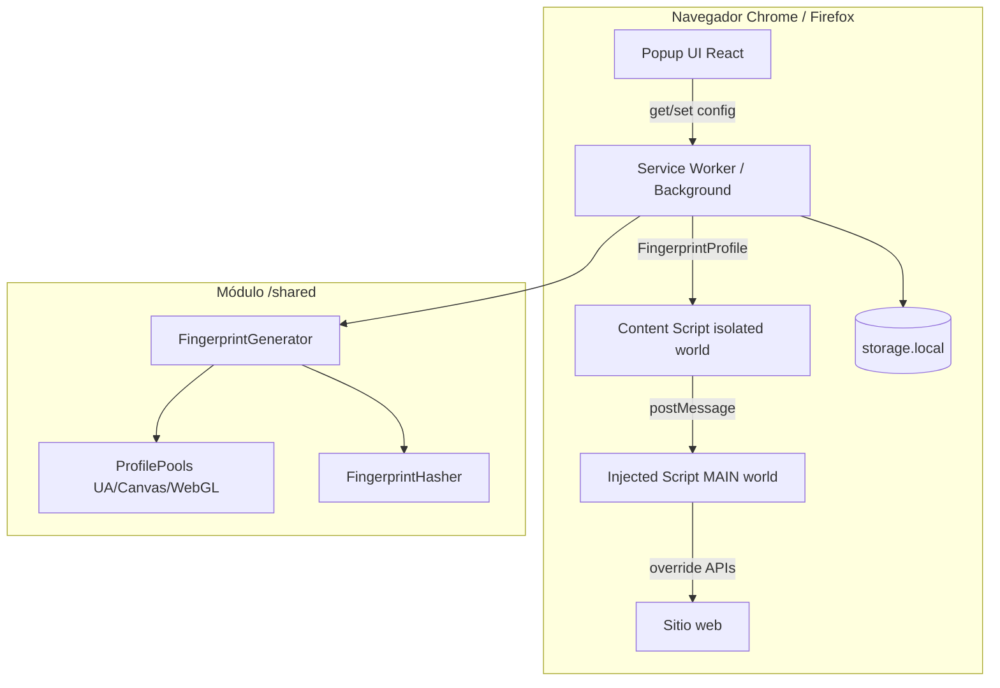
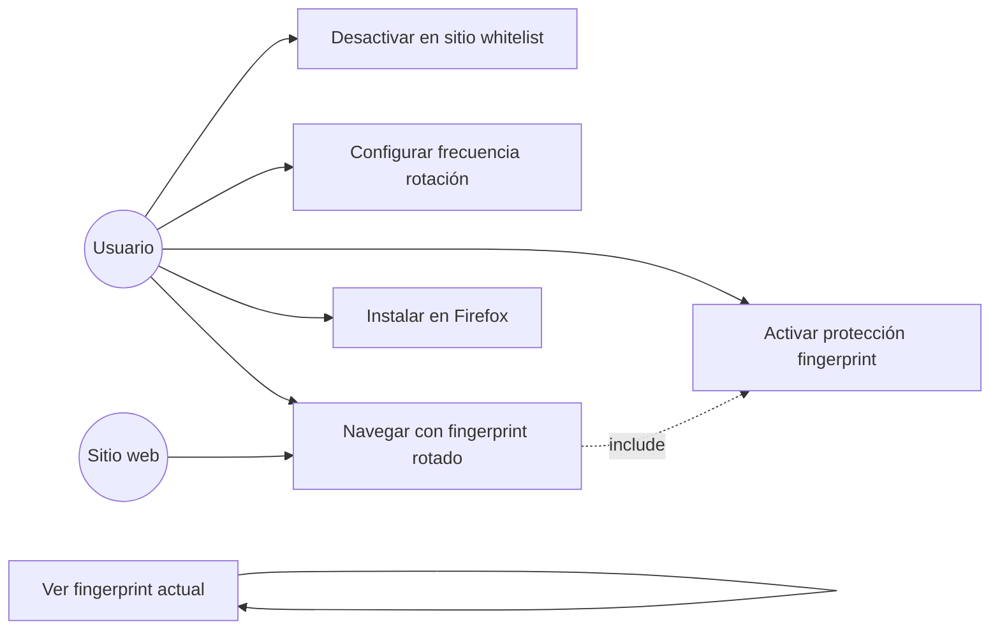
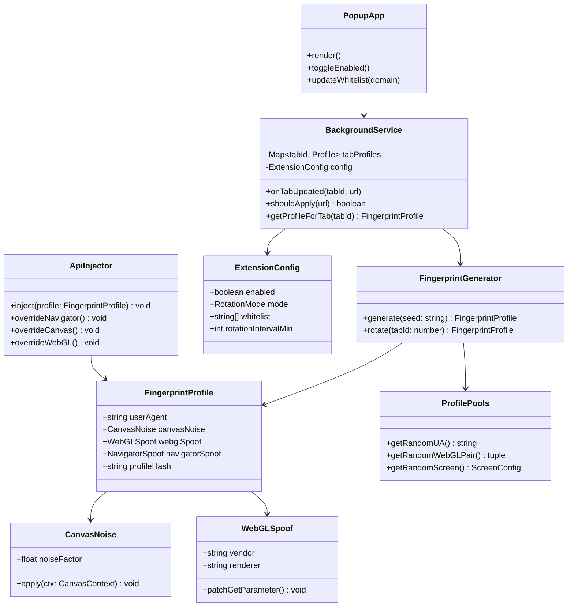
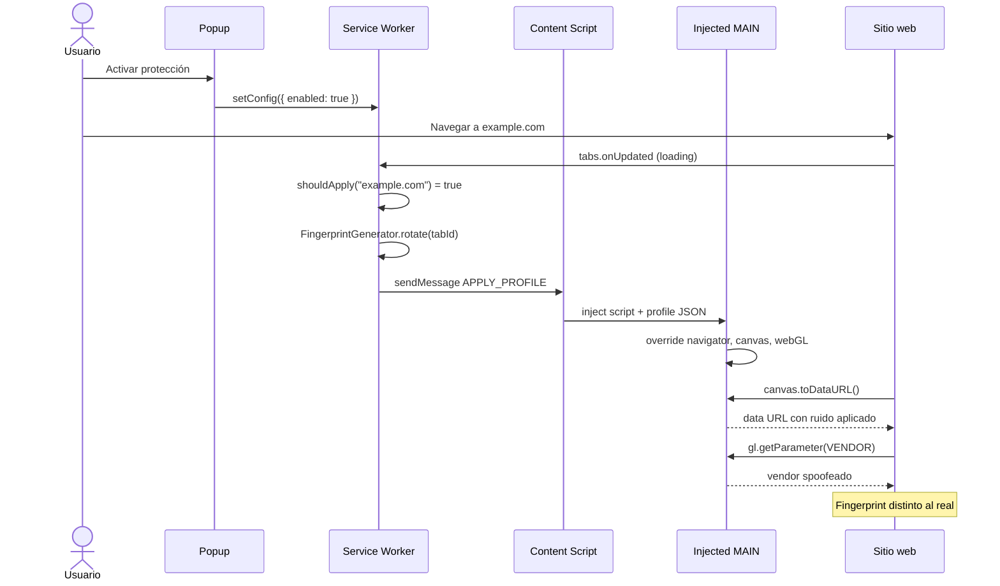
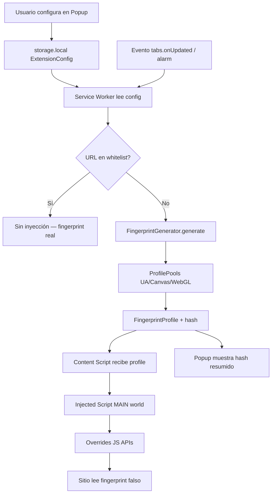
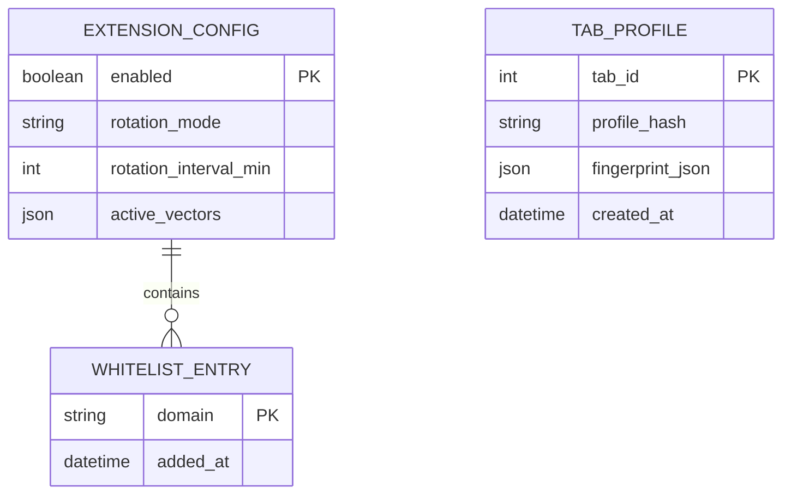

# Diseño y Arquitectura — Extensión Fingerprint Browser

## 1. Resumen Ejecutivo

**Extensión Fingerprint Browser** es una extensión de navegador para Chrome (Manifest V3) y Firefox (WebExtensions) que **rota aleatoriamente el fingerprint digital** que los sitios web extraen del navegador (User-Agent, canvas, WebGL, audio, resolución de pantalla, timezone, idioma, hardware concurrency, etc.). El objetivo es reducir la capacidad de rastreo cross-site basada en huellas digitales sin romper la navegación en sitios legítimos.

**Objetivo de negocio:** Ofrecer a usuarios conscientes de la privacidad una herramienta gratuita, local-first y transparente para dificultar el fingerprinting, con control explícito sobre qué vectores se randomizan y con qué frecuencia.

**Alcance del MVP (Release 1):** Extensión Chrome funcional que rota User-Agent, canvas fingerprint y WebGL renderer/vendor en cada carga de página o intervalo configurable, con popup de control y persistencia de configuración en `chrome.storage.local`.

---

## 2. Requisitos Funcionales (RF)

| ID | Requisito | Prioridad | Módulo |
|---|---|---|---|
| RF-001 | Sobrescribir `navigator.userAgent` con valor aleatorio de pool curado | Must | Content Script — UA |
| RF-002 | Randomizar salida de `HTMLCanvasElement.toDataURL()` y `getImageData()` | Must | Injected Script — Canvas |
| RF-003 | Spoofear parámetros WebGL: `VENDOR`, `RENDERER`, `UNMASKED_*` | Must | Injected Script — WebGL |
| RF-004 | Rotar fingerprint al cargar cada página (modo por defecto) | Must | Background — Rotación |
| RF-005 | Popup con toggle global activar/desactivar protección | Must | Popup UI |
| RF-006 | Popup con selector de frecuencia: por pestaña, por sesión, cada N minutos | Must | Popup UI |
| RF-007 | Lista blanca de dominios donde la extensión no aplica spoofing | Must | Background — Policy |
| RF-008 | Portar funcionalidad equivalente a Firefox con WebExtensions | Should | Firefox Build |
| RF-009 | Randomizar `AudioContext` fingerprint (oscillator + analyser) | Should | Injected Script — Audio |
| RF-010 | Spoofear `screen.width/height`, `devicePixelRatio`, `colorDepth` | Should | Content Script — Screen |
| RF-011 | Randomizar `navigator.language`, `languages`, `hardwareConcurrency`, `deviceMemory` | Should | Content Script — Navigator |
| RF-012 | Perfiles de fingerprint predefinidos (Windows Chrome, macOS Safari-like, Linux Firefox) | Could | Background — Profiles |
| RF-013 | Indicador visual en popup del fingerprint activo (hash resumido) | Could | Popup UI |

---

## 3. Requisitos No Funcionales (RNF)

| ID | Requisito | Métrica medible |
|---|---|---|
| RNF-001 | Impacto en tiempo de carga | Overhead ≤ 50 ms p95 por carga de página en sitio de referencia |
| RNF-002 | Compatibilidad Chrome | Chrome 120+ y Chromium-based (Edge, Brave) |
| RNF-003 | Compatibilidad Firefox | Firefox 115+ ESR |
| RNF-004 | Privacidad de datos | Cero telemetría; configuración solo en storage local del navegador |
| RNF-005 | Mantenibilidad | Código compartido ≥ 80 % entre builds Chrome y Firefox |
| RNF-006 | Seguridad | Content Security Policy de extensión sin `eval()`; scripts inyectados vía `world: MAIN` controlado |
| RNF-007 | Usabilidad | Activar/desactivar protección en ≤ 2 clics desde icono de extensión |
| RNF-008 | Estabilidad | 0 errores de consola propios en top 50 sitios Alexa en modo protección activa |
| RNF-009 | Cumplimiento tiendas | Manifest V3 compliant para Chrome Web Store |
| RNF-010 | Testabilidad | Cobertura unitaria ≥ 80 % en módulos `fingerprint`, `pools`, `injector` |

---

## 4. Arquitectura del Sistema

Se adopta la arquitectura estándar de **extensión WebExtensions en 4 capas**: Background Service Worker (orquestación y política), Content Scripts (acceso DOM aislado), Injected Scripts en `MAIN world` (sobrescritura de APIs JavaScript antes de scripts de la página) y Popup UI (control del usuario). La lógica de generación de fingerprints vive en un **módulo compartido TypeScript** (`/shared`) compilado a bundles separados para Chrome MV3 y Firefox.

**Justificación:** La separación MAIN world / isolated world es obligatoria para interceptar APIs nativas (`CanvasRenderingContext2D`, `WebGLRenderingContext`) antes de que el sitio las invoque. El service worker centraliza rotación y whitelist para evitar estado inconsistente entre pestañas.



---

## 5. Diagramas Técnicos

### 5.1 Diagrama de Casos de Uso



### 5.2 Diagrama de Clases (UML)



### 5.3 Diagrama(s) de Secuencia

#### Flujo crítico: Carga de página con rotación de fingerprint



---

## 6. Flujo de Datos



---

## 7. Modelo de Datos

No hay base de datos externa. Estado persistido en `browser.storage.local`.

### 7.1 Esquema `ExtensionConfig`

```json
{
  "enabled": true,
  "rotationMode": "per_navigation",
  "rotationIntervalMin": 15,
  "whitelist": ["bank.example.com", "accounts.google.com"],
  "activeVectors": ["userAgent", "canvas", "webGL"],
  "selectedProfile": "random"
}
```

### 7.2 Esquema `FingerprintProfile` (runtime, por pestaña)

```json
{
  "seed": "tab-12847-1717512345",
  "userAgent": "Mozilla/5.0 (Windows NT 10.0; Win64; x64) AppleWebKit/537.36 ...",
  "canvasNoise": { "r": 0.0003, "g": 0.0002, "b": 0.0004 },
  "webglSpoof": {
    "vendor": "Google Inc. (NVIDIA)",
    "renderer": "ANGLE (NVIDIA GeForce GTX 1060)"
  },
  "navigatorSpoof": {
    "language": "en-US",
    "languages": ["en-US", "en"],
    "hardwareConcurrency": 8,
    "deviceMemory": 8
  },
  "profileHash": "a3f8c2..."
}
```

### 7.3 Diagrama ER (storage)



---

## 8. Historias de Usuario (nivel épica)

| Épica | Historia resumida |
|---|---|
| EP-01 | Como **usuario preocupado por privacidad**, quiero **que mi fingerprint cambie automáticamente**, para **dificultar el rastreo entre sitios**. |
| EP-02 | Como **usuario**, quiero **activar o desactivar la protección fácilmente**, para **controlar cuándo aplicarla**. |
| EP-03 | Como **usuario**, quiero **excluir sitios bancarios de la protección**, para **evitar bloqueos o CAPTCHAs**. |
| EP-04 | Como **usuario de Firefox**, quiero **la misma extensión en mi navegador**, para **no depender solo de Chrome**. |
| EP-05 | Como **usuario avanzado**, quiero **elegir qué vectores se randomizan**, para **equilibrar privacidad y compatibilidad**. |

---

## 9. Stack Tecnológico

| Capa | Tecnología | Justificación |
|---|---|---|
| Lenguaje | TypeScript 5.4+ | Tipado fuerte; código compartido Chrome/Firefox |
| Bundler | Vite 5 + `@crxjs/vite-plugin` (Chrome) / `web-ext` (Firefox) | HMR en desarrollo; builds MV3 correctos |
| UI Popup | Preact 10 + Tailwind CSS 3 | Bundle pequeño (< 50 KB); suficiente para popup |
| Background | Service Worker MV3 (Chrome) / Background scripts (Firefox) | Requisito Manifest V3 |
| Inyección | `chrome.scripting.executeScript({ world: 'MAIN' })` | Única forma fiable de parchear APIs en página |
| Storage | `chrome.storage.local` / `browser.storage.local` | API estándar WebExtensions |
| Testing unitario | Vitest 1.x | Rápido; compatible con Vite |
| Testing E2E | Playwright + extensión cargada | Validación real en browser |
| Linting | ESLint + Prettier | Consistencia en monorepo |
| CI | GitHub Actions | Build ambos targets + tests en PR |

---

## 10. Decisiones de Arquitectura (ADR resumido)

| # | Decisión | Alternativas descartadas | Motivo |
|---|---|---|---|
| ADR-01 | Inyección MAIN world con overrides JS | Solo declarativeNetRequest modificar headers | DNR no puede spoofear canvas/WebGL/audio |
| ADR-02 | Monorepo `/shared` + 2 manifests | Dos repos separados | 80 %+ código idéntico; un solo lugar para pools |
| ADR-03 | Pools estáticos curados vs generación ilimitada | Fingerprint completamente aleatorio | UA/WebGL inválidos rompen sitios; pools realistas reducen detección como bot |
| ADR-04 | Rotación por navegación como default | Rotación solo manual | Máxima protección cross-site con mínima configuración |
| ADR-05 | Whitelist por dominio exacto | Regex complejas | Simplicidad; usuario entiende qué excluye |
| ADR-06 | Preact sobre React en popup | React 18 | Menor tamaño de bundle para extensión |
| ADR-07 | Sin backend / telemetría | Servidor de sync de perfiles | Alineado con privacidad; local-first |
